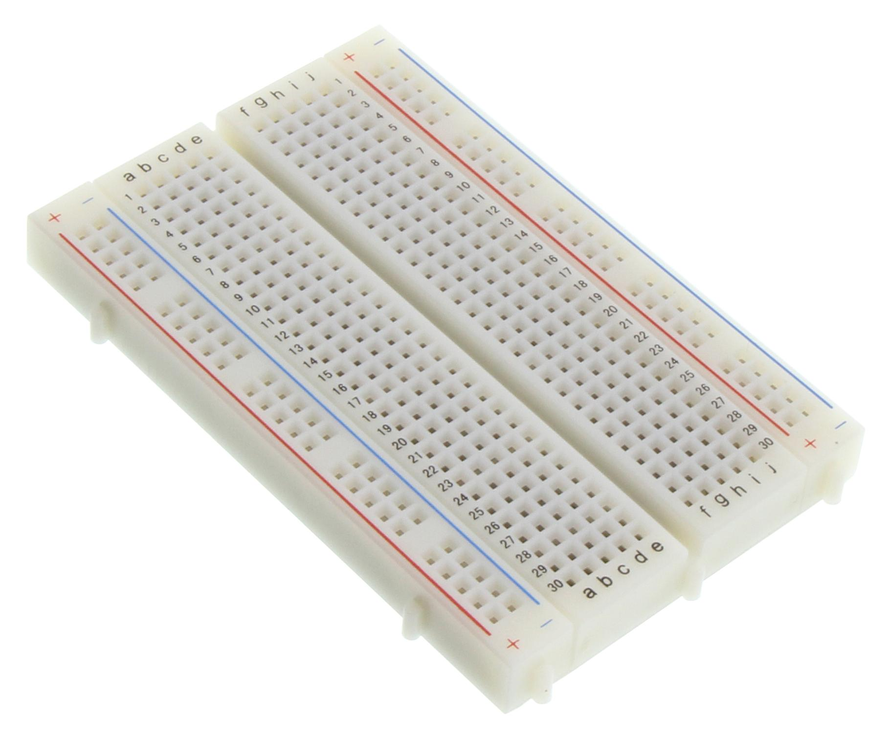
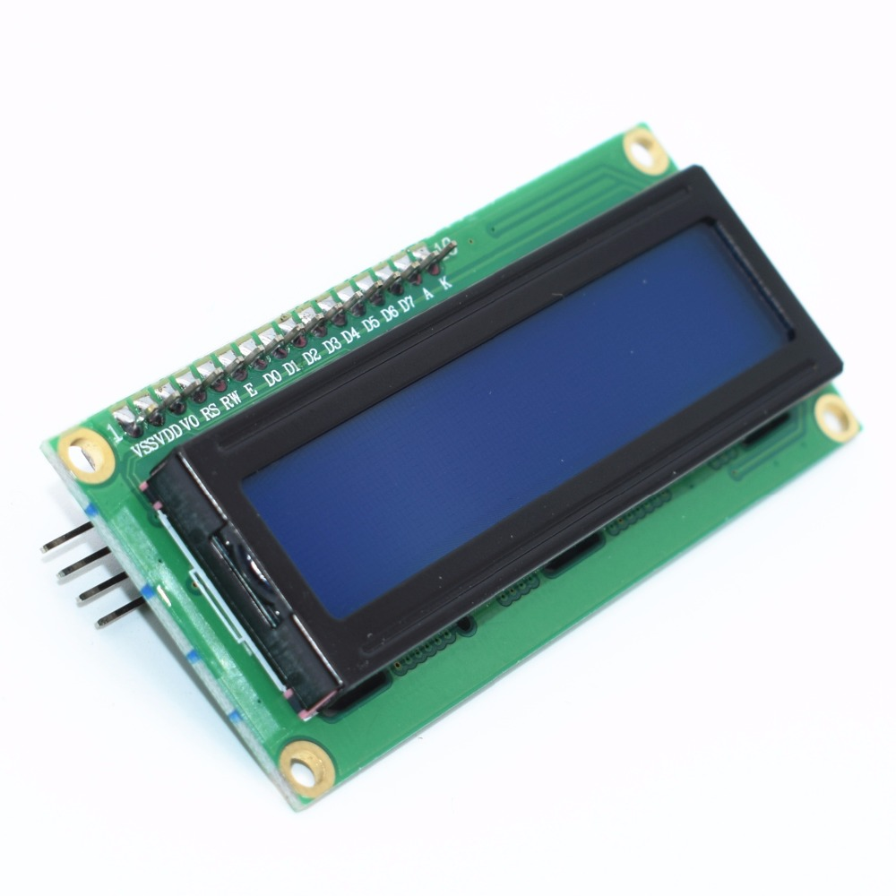
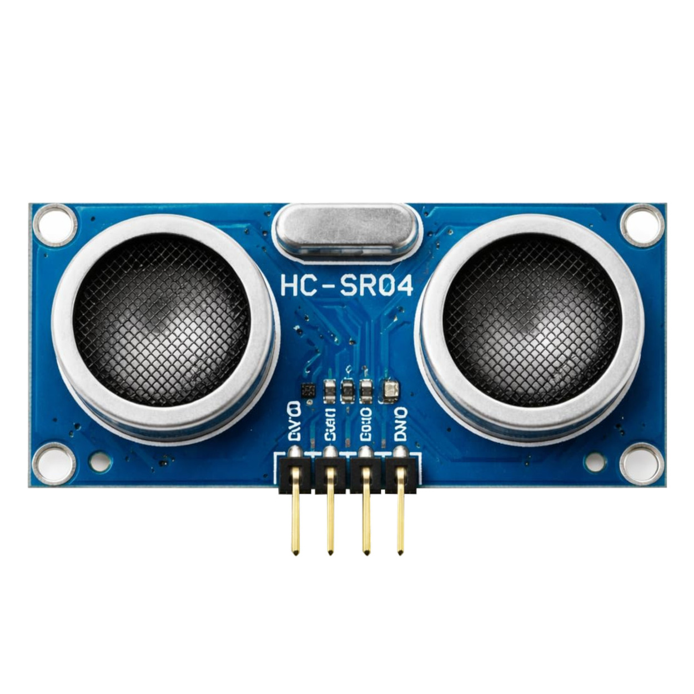

# Physical Computing Project 2026 - IT KMITL

## TargetZero
- Project นี้เป็นส่วนหนึ่งในรายวิชา Physical Computing รหัสวิชา 06016409 ภาคเรียนที่ 1 ปีการศึกษา 2569 ของคณะเทคโนโลยีสารสนเทศ
  สาขาเทคโนโลยีสารสนเทศ สถาบันเทคโนโลยีพระจอมเกล้าเจ้าคุณทหารลาดกระบัง

## บทคัดย่อ
- TargetZero คือเกมกะระยะที่ผสานฮาร์ดแวร์กับเว็บแอปพลิเคชันเข้าด้วยกัน ระบบสุ่มระยะเป้าหมาย ผู้เล่นใช้เซ็นเซอร์อัลตราโซนิก HC-SR04 ที่ต่อกับ Arduino UNO R4 WiFi วัดระยะด้วยการเคลื่อนวัตถุเข้า-ออก แล้วกดปุ่มล็อกค่า ระบบจะหักระยะที่ล็อกออกจากเป้าหมายแบบสะสมเป้าหมายคือทำให้ระยะคงเหลือเป็น 0 (อยู่ในช่วงความคลาดเคลื่อนที่ตั้งไว้) โดยห้ามติดลบ ข้อมูลระยะทางถูกส่งผ่าน MQTT แบบเรียลไทม์ไปยังหน้าเว็บ ซึ่งแสดงผลค่าสด คงเหลือ สถิติ และเอฟเฟกต์ชนะ/แพ้

## อุปกรณ์และ Library ที่ใช้
- **อุปกรณ์**
  - Arduino R4 WIFI
    - 
  - BreadBoard
    - 
  - LCD
    - 
  - Ultrasonic sensor
    - 
- **Library**
  - WiFiS3.h
  - MQTTClient.h
  - LiquidCrystal_I2C.h
  
## Website
[TargetZero](https://chamanow1.github.io/TargetZero/)

## Poster

## Video

## สมาชิก
| ID | ชื่อ-นามสกุล | งานที่รับผิดชอบ | รูป |
| -- | ---------- | -------------| --| 
| 68070037 | ณฐมน อำไพสุทธิพงษ์ | Github, Website, Video, Arduino |  |
| 68070046 | ณิชาภัทร เลิศภูตราช | Github, Poster, Video, Arduino |  |
| 68070090 | บรรณสรณ์ ถินถาวร | Github, Website, Video, Arduino |  |
